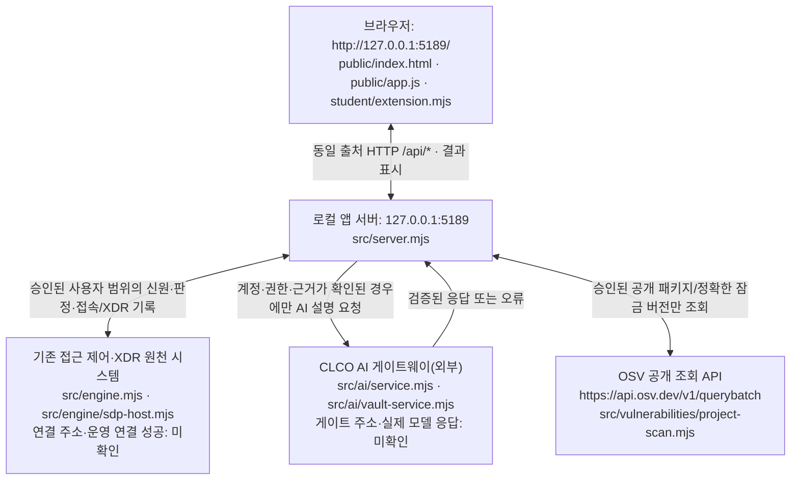

# 겨울철방어 — 학생용 실행 설명서와 텍스트 시스템 구성도 (21단계)

> 이 문서는 `on-client` 학생 앱의 **현재 코드로 확인한 실행 방법**을 기록한다. 앱 실행, 외부 SDP·XDR 연결, CLCO AI 응답, ALEPH 과제 판정은 각각 다른 확인 항목이다. 제공 설명서 `README.md`와 `docs/STUDENT_LAUNCH_GUIDE.md`는 덮어쓰지 않는다.

## 1. 목적·기능·지원 범위

**겨울철방어**는 자기 계정·기기·세션, 업무 앱 접근 판정, 보안 기록과 XDR 경보, 근거에 따른 AI 설명, 보안 조치의 요청·결과 상태, 공개 승인된 설치 패키지의 OSV 조회 결과를 **구분해 표시하는 학생용 로컬 보안 Agent 앱**이다. 실제 접근 제어·XDR 판정과 조치 집행의 권한은 학생 화면에 없으며 연결된 원천 서버/운영자에게 있다.

| 구분 | 코드에서 확인한 사실 | 실행 확인 상태 |
|---|---|---|
| 앱 메타데이터 | `package.json`: `alekov-client-starter`, `0.2.14`, `type: module`; `engines.node: 24.19.0` | GitHub 원문 확인, PC 실행 미확인 |
| 실행 도구 | `tools/start-alekov.ps1`는 Node.js 22~24를 허용하고 24.19.0을 수업 기준으로 안내 | 스크립트 원문 확인, 사용자의 Node 버전 미확인 |
| 패키지 | `package.json`에 외부 `dependencies`·`devDependencies`가 없고 `on-client/package-lock.json`도 현재 저장소에서 발견되지 않음 | 저장소 파일 확인; 별도 `npm install`을 필수 절차로 제시하지 않음 |
| 실행 환경 | Windows PowerShell 실행 도구, Node.js, PC 브라우저; 서버의 기본 바인딩은 `127.0.0.1` | 코드상 지원·구성 확인, 사용자 PC 정상 실행 미확인 |
| 지원하지 않거나 미확인한 범위 | macOS·Linux에서 PowerShell 도구 사용, 실제 기업 계정/SDP·XDR 연결, 유료 AI 추론, 실제 조치 효과, OSV 실조회, 최신 버전의 전체 브라우저 동작 | **미확인** — 작동했다고 기록하지 않음 |

**실제 확인 버전과 설정 버전은 다르다.** `24.19.0`은 프로젝트가 선언한 버전이며 작성자가 사용자의 PC에서 `node --version`을 실행해 얻은 관측값이 아니다. 실행 후 표시되는 실제 버전과 확인 시각을 직접 기록한다.

## 2. 폴더 구조와 작업 위치

`Git 저장소 최상위 폴더` 아래의 `on-client`가 **앱 실행 폴더**이다. 아래 경로는 현재 저장소의 원문을 조회해 확인했다.

```text
choi-bujang-secret-vault/        ← Git 저장소 최상위; 커밋/제출 준비 위치
└── on-client/                  ← PowerShell을 열고 앱을 실행하는 위치
    ├── README.md               제공 시작 안내
    ├── package.json            start, demo, check 명령과 Node 버전
    ├── .env.example            비밀이 없는 설정 견본; 실제 자격값 아님
    ├── tools/
    │   └── start-alekov.ps1    제공 실행 도구
    ├── src/
    │   ├── server.mjs          로컬 HTTP 서버/API
    │   ├── engine.mjs          연결 없음/예제/어댑터 선택
    │   ├── engine/sdp-host.mjs 기존 접속·XDR 호스트 연결 경계
    │   ├── ai/service.mjs      AI 요청 서비스
    │   ├── ai/vault-service.mjs AI 앱 자격 보관함 이용 경계
    │   └── vulnerabilities/project-scan.mjs  승인 패키지·OSV 조회
    ├── student/
    │   ├── extension.mjs       학생 화면 렌더러
    │   └── engine-adapter.mjs  원천 서버 어댑터의 제공 연결 틀
    ├── public/
    │   ├── index.html          제공 화면·버튼
    │   ├── app.js              제공 호출·상태·새로고침 제어
    │   └── vulnerabilities-view.mjs 제공 OSV 결과 검증·표
    └── docs/
        ├── STUDENT_LAUNCH_GUIDE.md  제공 실행 안내
        ├── CONNECTION_TROUBLESHOOT.md 제공 오류 안내
        └── STUDENT_RUNBOOK.md       이 21단계 학생 문서
```

`student/extension.mjs`와 문서는 Git에 저장하되 개인 자격 설정, 키, 토큰, 비밀번호 및 사설 호스트 주소는 Git·문서·제출 원문에 넣지 않는다. 앱 설정 경로는 담당자가 안내한 경우에만 사용한다.

## 3. 설치·실행·종료·재실행 (Windows PowerShell)

**작업 위치:** 파일 탐색기에서 본인 프로젝트의 실제 `on-client` 폴더를 연다. 탐색기 주소 표시줄에 `powershell`을 입력해 **새 PowerShell 창**을 연다. 다운로드 폴더나 `on-client` 상위 폴더에서 상대경로 명령을 실행하지 않는다.

**먼저 실제 Node 버전을 확인:** 다음은 사용자 PC에서 실행해야 하는 확인 명령으로, 이 문서 작성 시 **미실행**이다.

```powershell
node --version
```

수업 기준은 `v24.19.0`; 실행 도구의 허용 범위는 Node.js 22~24이다. Node.js가 없으면 `https://nodejs.org/`에서 설치하고 새 PowerShell 창에서 확인한다. **현재 앱의 package.json에는 외부 npm 패키지 설치 단계가 없다.**

**실행:** 실제 파일 `tools/start-alekov.ps1`에 정의된 명령이다. 기존 작업 파일은 삭제하지 않는다. 단, 기본 실행 도구는 필요할 때 프로젝트 **밖의 개인 사용자 폴더**에 계정 연결 준비 정보를 생성·재사용할 수 있다. 이 준비는 로그인 승인이나 AI 연결 성공이 아니다.

```powershell
powershell -NoProfile -ExecutionPolicy Bypass -File .\tools\start-alekov.ps1
```

**정상 시작 신호(예상 문자열, 실제 PC 관측 아님):**
- `케셰브가 켜졌습니다. 브라우저에서 http://127.0.0.1:5189/ 을 여세요.`
- `서버가 응답한 것만 확인했습니다. AI 연결 상태는 화면에서 따로 확인해 주세요.`
- 브라우저에서 `http://127.0.0.1:5189/`로 접속하고 **「보호 현황」, 「업무 앱」, 「보안 기록」** 탭을 확인한다. 시작 문구에 남아 있는 “케셰브”는 제공 실행 도구의 출력으로, 학생 Agent 이름 “겨울철방어”와 다를 수 있다.

로컬 서버는 `src/server.mjs`에서 `127.0.0.1`에 바인딩한다. 시작 도구가 HTTP 200을 확인하는 것은 **로컬 서버 응답**이지 SDP 접속·AI 권한·보안 조치·과제 통과의 증거가 아니다.

**종료:** 앱을 실행한 PowerShell 창에서 `Ctrl+C`를 누른다. 브라우저 탭을 닫는 것만으로 서버가 종료되지는 않는다.

**재실행:** 같은 `on-client` 폴더에서 위 실행 명령을 다시 입력한다. 화면을 새로고침해 상태를 다시 확인한다. 이 절차는 사용자 PC에서 수행하기 전까지 미확인이다.

**포트 충돌 시:** 기존 프로세스를 강제로 종료하지 않고, 실행 도구에 실제로 정의된 `-Port` 옵션을 사용한다.

```powershell
powershell -NoProfile -ExecutionPolicy Bypass -File .\tools\start-alekov.ps1 -Port 5190
```

이 경우 브라우저 주소도 `http://127.0.0.1:5190/`로 바꾼다. 개인 연결을 건드리지 않는 **예제 화면 확인**은 `-Demo`, 자동 계정 연결 준비를 사용하지 않는 로컬 확인은 `-NoNativeHost` 옵션을 사용한다. `-Demo`는 실제 원천 연결 성공이 아니며 SDP 연결 옵션과 함께 사용하지 않는다. 다른 코드 경로의 `npm start`·`npm run demo`도 `package.json`에 있지만, 기본 재현은 위 제공 PowerShell 도구로 한다.

**학생 파일 문법 확인(서버 실행·화면 검사는 아님):**

```powershell
npm run check
```

이 명령은 `node --check student/extension.mjs`만 실행한다. 성공해도 실제 인증·AI·OSV 요청이나 기능 판정이 통과했다는 뜻이 아니다. 위 명령들은 모두 **코드 또는 제공 문서에서 존재를 확인했으며 사용자 PC에서는 아직 실행하지 않았다.**

## 4. 시스템 구성도 (글로 판정할 수 있는 Mermaid)



**같은 구조를 텍스트로 설명:** 브라우저가 `public/app.js`에서 로컬 `src/server.mjs`의 `/api/*`에 요청한다. 서버는 원천 엔진과 호스트 연결이 준비된 경우에만 현재 사용자 범위의 접근 제어·XDR 정보에 접근하며, 결과를 제공 화면과 `student/extension.mjs`의 학생 화면에 전달한다. 원천 엔진이 연결되지 않았거나 결과를 검증하지 못하면 정상 판정으로 바꾸지 않는다.

AI 사건 설명은 로컬 서버의 `src/ai/service.mjs` 또는 자격 보관함 경계인 `src/ai/vault-service.mjs`를 통해 외부 CLCO에 요청한다. 원천 사건 근거, 동일 사용자/프로젝트 결속 및 현재 앱 AI 권한 확인이 필요하며 AI는 접근 허용이나 조치 효과를 결정하지 않는다. 운영 CLCO URL과 원천 SDP 서버 주소는 공개된 고정 주소로 확인되지 않아 문서에 만들어 넣지 않았다.

설치 패키지 조회는 별도 경로 `GET /api/vulnerabilities`에서 `src/vulnerabilities/project-scan.mjs`를 사용한다. 원천 프로젝트와 공개 조회 승인 목록이 없는 상태에서는 OSV 외부 조회가 일어나지 않을 수 있다. `ON_APPROVED_PUBLIC_PACKAGES=[]`는 `.env.example`에 있는 비밀 없는 **견본**이며, 실제 환경에서 자동 적용됐다는 뜻이 아니다.

## 5. 제공 코드와 학생 작성 코드

| 분류 | 파일·함수 | 현재 역할 및 입력 계약 | 확인 수준 |
|---|---|---|---|
| 제공 | `public/index.html` | 탭·버튼·제공 영역과 학생 표시 영역 분리 | 원문 확인 |
| 제공 | `public/app.js` | `/api/*` 요청, `idle/loading/error/ok`, 새로고침·이전 응답 차단, 학생 뷰에 자료 전달 | 코드 확인 |
| 제공 | `src/server.mjs`, `src/engine.mjs` | 로컬 HTTP 서버, 원천 연결·실패·예제 상태 구분 | 코드 확인 |
| 제공 | `public/vulnerabilities-view.mjs` | OSV 응답 계약 검증과 제공 표 | 코드 확인 |
| 학생 | `student/extension.mjs: createStudentView()` | 각 학생 `render*` 함수를 반환, 제공 앱에서 호출 | 코드 확인 |
| 학생 | `renderIdentity({me,devices,sessions})` | 사용자·기기·세션별 `status/mode/data/error` 표시 | 코드 확인 |
| 학생 | `renderDecision(input)` | `allow/deny/challenge/unknown`, 판정 근거와 요청 실패 구분 | 코드 확인 |
| 학생 | `renderEvents(input)` | `access/xdr` 기록과 근거·규칙·필터·상세 표시 | 코드 확인 |
| 학생 | `renderStatus(input)` | 기기·세션 보안 상태 및 알림 표시 | 코드 확인 |
| 학생 | `renderAiConnection(input)` | AI 연결 상태와 결과의 출처·실패 구분 | 코드 확인 |
| 학생 | `renderExplanation(input)` | 선택한 사건의 근거에 연결된 AI 설명과 제안 표시 | 코드 확인 |
| 학생 | `renderAction(input)` | 준비·사람 확인·접수·효과 관측과 결과 불명 구분 | 코드 확인 |
| 학생 | `renderVulnerabilities({status,mode,data?,error?})` | 설치된 정확한 버전과 OSV 출처·시각, 미조회·일부 실패 표시 | 코드 확인 |
| 문서(21단계) | `docs/STUDENT_RUNBOOK.md` | 실행 위치, 구성도, 제공/학생 경계, 장애 대응과 미확인 기록 | 이 문서 |

`data-student-package-name`, `data-student-package-version`은 `renderVulnerabilities`의 행 구분에 쓰이는 기존 속성 이름이다. 이 단계에서는 속성·버튼·DOM을 수정하지 않는다. 제공 코드의 검증·요청 처리와 학생 렌더링의 책임도 뒤섞지 않는다.

## 6. 화면·오류별 확인 순서

| 실제 화면/응답 상태 또는 코드 | 의미 | 확인·복구 순서 |
|---|---|---|
| `Node.js 가 없습니다`, 버전 안내 | 실행 도구의 Node 확인 실패 | 새 PowerShell의 `node --version` → Node.js 22~24 확인(수업 기준 24.19.0) → 같은 폴더에서 재실행 |
| `포트 5189 를 다른 프로그램이 쓰고 있습니다` | 루프백 포트 충돌 | 기존 프로그램을 종료하지 않고 `-Port 5190`으로 실행 → `:5190/` 접속 |
| `앱 폴더가 아닙니다`, `시작 틀 폴더가 아닙니다` | 작업 경로 또는 시작 틀 불일치 | 실제 `on-client/package.json`과 `tools/start-alekov.ps1` 위치 확인 |
| `ENGINE_NOT_CONNECTED`, `disconnected` | 원천 접속·XDR 엔진 연결 없음 | 현재 모드·개인 호스트 연결 준비 상태 확인 → 담당자에게 제공 도움정보 전달. 예제를 실제 자료로 간주하지 않음 |
| `ENGINE_RESULT_UNVERIFIED`, `CONTRACT_MISMATCH`, `unknown` | 응답 계약 또는 결과 검증 불가 | 오류 코드·시각·현재 원천 상태 확인 → 다시 불러오기 → 계속되면 담당자 확인. 허용/정상/빈 결과로 해석하지 않음 |
| `ON_AI_PROVISIONING_PENDING` | 앱 AI 사용 권한·현재 계정 연결 확인 불가 | 「계정 연결 확인」 → AI 승인 상태 → 「현재 API 연결 점검」 순으로 확인, 운영자에게 권한 준비 여부 문의 |
| `WB_CLCO_RATE_LIMITED`, `WB_CLCO_TIMEOUT`, `WB_CLCO_NETWORK_ERROR` | 게이트 제한·시간 초과·통신 실패 | 앱 서버·현재 AI 연결·상태 확인 → 필요한 경우 사용자가 직접 재요청. AI 성공으로 표시하지 않음 |
| `CANCELLED`, `TIMEOUT`, `SERVICE_UNAVAILABLE`(패키지) | OSV 조회 취소·기한 초과·서비스 처리 불가 | 「설치 패키지 조회」에서 오류 확인 → 원천 프로젝트·승인 범위·연결 상태 확인 → 필요하면 직접 재조회 |
| `not_configured`, `not_checked` | 프로젝트 연결 미설정 / 승인된 패키지 미조회 | `ON_PROJECT_DIRECTORY`, 승인 목록의 **설정 여부만** 운영자와 확인; “취약점 없음”으로 기록하지 않음 |
| `unverifiable`, `partial` | 확인 불가 또는 일부 조회 | 조회된 행·조회 실패 행을 분리해 보존하고, 잠금 파일 버전·해시·시각과 승인 범위를 확인 |
| `none_found` | 조회 범위·시각에서 알려진 OSV 항목 없음 | **안전성 보장 아님**. `not_checked`·`unverifiable`과 구분 |
| `ACTION_TIMEOUT`, `unknown`(조치) | 조치 효과 또는 최종 결과 미확인 | 새로운 집행을 반복하지 않고 제공 화면의 「원천 결과만 재조회」로 상태 확인. `succeeded` 문구만으로 효과를 단정하지 않음 |

화면의 정확한 버튼 표기는 `public/index.html`과 `public/app.js`를 기준으로 한다: 「보호 현황」, 「업무 앱」, 「보안 기록」, 「다시 불러오기」, 「도움정보 불러오기」, 「AI 연결 시작」, 「현재 API 연결 점검」, 「설치 패키지 조회」, 「패키지 조회 취소」. 연결·조치 버튼은 현재 상태·권한에 따라 비활성화될 수 있다. 오류가 나면 화면의 **「도움정보 불러오기」** 또는 **「연결 도움정보 보기」**로 비밀 없는 상태를 확인하고, 전달 전에 내용을 직접 검토한다. 오류 안내의 세부 기준은 제공 `docs/CONNECTION_TROUBLESHOOT.md`와 코드가 원천이다.

## 7. 확인한 항목 / 기다림(UNV)

| 항목 | 판정 | 근거 또는 남은 작업 |
|---|---|---|
| 실행 명령·실행 위치·버전 선언·포트·상태 메시지 | **코드 확인** | `package.json`, `tools/start-alekov.ps1`, `src/server.mjs` |
| 화면 메뉴·버튼·제공/학생 표시 경계 | **코드 확인** | `public/index.html`, `public/app.js` |
| 학생 `render*` 8개 함수 존재 및 역할 | **코드 확인** | `student/extension.mjs`; 현재 문서 작성 시 수정 없음 |
| 사용자 PC의 새 PowerShell에서 실행·종료·재실행 | **미확인(UNV)** | 사용자가 직접 실행, 실제 Node 버전과 시작 문구 기록 필요 |
| 실제 브라우저 탭·버튼·경로 대조 | **미확인(UNV)** | 사용자가 실행 뒤 직접 확인 |
| 기존 접근 제어·XDR 계정 연결 및 실제 사건 | **미확인(UNV)** | 허가된 환경과 동일 사용자/프로젝트 범위 필요 |
| 현재 앱의 CLCO 권한·실제 AI 모델 응답 | **미확인(UNV)** | 연결 점검·생성 응답 구분, 유료 요청 임의 실행 금지 |
| 실제 조치 집행 및 원천 효과 관측 | **미확인(UNV)** | 확인된 영수증·원천 관측 전까지 성공 아님 |
| 실제 승인 패키지의 정확한 버전·OSV 결과 | **미확인(UNV)** | 호스트 설정·승인 목록·lock 원천 및 실제 응답 확인 필요 |
| 21단계 ALEPH AI 판정·공식 통과 | **미확인(UNV)** | 문서 생성이나 원문 전달만으로 통과 아님 |

이 표에는 **모의 데이터로 실행한 검사도 현재 단계에서 새로 수행하지 않았으며, 실제 브라우저 확인도 하지 않았다**고 구분한다. 이전 단계에서 작성한 코드를 읽은 것은 현재 PC에서 실행한 결과가 아니다.

## 8. 학생 직접 확인 순서 (하나씩 수행)

**확인 1 — 우선 실행:** 현재 작업을 보존한다. Git 최상위 폴더에서 커밋되지 않은 다른 변경이 있는지 학생이 직접 확인한 뒤, 기존 앱은 지우지 않고 새 PowerShell 창을 `on-client`에서 열어 3장의 `node --version`과 실행 명령을 차례로 실행한다. **성공 예상 화면은 3장에 적은 서버 안내와 브라우저 「보호 현황」**이다. 성공·실패와 실제 버전은 확인 전까지 미확인으로 둔다.

**확인 2 — 확인 1 뒤에 수행:** 폴더·명령·실제 탭/버튼 이름을 `package.json`, `tools/start-alekov.ps1`, `public/index.html`과 대조한다. 운영 연결 없이 확인할 수 없는 항목은 **미확인(UNV)**으로 기록한다.

## 9. 21단계 커밋 및 원문 제출 범위

- 이 단계에서 수정할 학생 원문은 **새 문서 `on-client/docs/STUDENT_RUNBOOK.md`**뿐이다. 제공 서버, `public/app.js`, 인증 설정, 판정 코드와 기존 학생 함수는 변경하지 않는다. 이미 작업 중인 다른 변경이 있으면 학생이 먼저 `git status`와 변경 내용을 확인하고 보존한다.
- **커밋 위치는 Git 최상위 폴더**다. 파일을 저장한 것과 40자리 커밋을 만든 것은 다르다. 21단계 과제 화면에 **저장소 HTTPS 주소와 실제 40자리 커밋을 직접 입력**한다. 비공개 저장소를 공개로 변경할 필요가 없다.
- 비공개 저장소라면 21단계 화면의 **「비공개 저장소 원문 준비 방법」 → 「원문 전달 도구 받기」**를 사용한다. ZIP과 JSON 출력 폴더는 프로젝트 밖에 둔다. 도구의 정확한 `student-source-cli.mjs` 명령 및 `--commit` 인수는 **실제 다운로드한 도구와 과제 화면 안내를 대조한 뒤** 학생 PC의 Git 최상위 폴더에서 실행한다. 여기서는 다운로드 경로나 도구 명령을 만들어 적지 않는다.
- 생성한 JSON은 같은 단계의 **「비공개 저장소 원문 묶음」**에 선택한다. 저장소·40자리 커밋·21단계를 확인해 제출하고, **원문 전달 완료와 AI 검토 통과를 구분**한다. 원문 전달만 실패한 경우에는 기존 접수를 보존한 채 과제 화면의 **「원문만 다시 보내기」**를 따른다.
- 이 설명서 작성·커밋은 실행 확인, 유료 AI 요청, 보안 조치, 과제 제출을 자동으로 수행하지 않는다.
