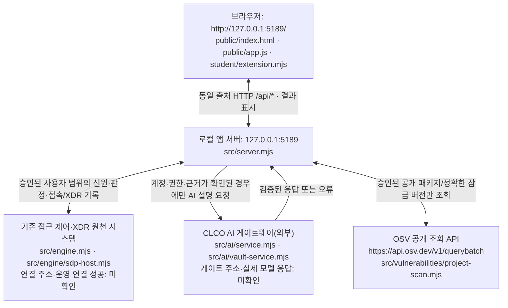

# 겨울철방어 — 학생용 실행 설명서와 텍스트 시스템 구성도 (21단계)

## 처음 실행하는 사람을 위한 한 장 안내

**대상:** Windows의 일반 사용자 계정. 관리자 PowerShell을 열지 않는다. 기존 프로젝트와 제출물을 지우거나 옮기지 않는다. 포장·설치·제출 명령은 필요 없다.

1. 파일 탐색기에서 기존 프로젝트의 **`on-client`** 폴더를 연다. `package.json`, `src`, `student`가 보이는지 확인하고, 주소 표시줄에 `powershell`을 입력한다.
2. 그 창에서 아래 명령을 한 줄씩 실행한다. Node.js 기준 버전은 **24.19.0**이다. 문법 검사는 `npm.cmd`로 실행하고, **계정·AI 연결을 사용하는 실제 앱 실행은 제공 실행 도구로 한다.**

   ```powershell
   node --version
   npm.cmd run check
   powershell -NoProfile -ExecutionPolicy Bypass -File .\tools\start-alekov.ps1
   ```

3. `케셰브가 켜졌습니다`가 나오면 창을 그대로 두고 **본인 PC 브라우저**에서 `http://127.0.0.1:5189/`를 연다. 제공 앱 이름은 케셰브, 학생 대시보드 이름은 겨울철방어로 보일 수 있다. 제공 실행 도구는 **같은 프로젝트 경로의 개인 연결 설정을 준비·재사용하고 서버에 전달**한다. 기존 설정·프로젝트 경로는 바꾸지 않는다. **「계정 연결 확인」 → AI 사용 승인(「AI 연결 시작」) → 「현재 API 연결 점검」** 순으로 확인한다. 서버 시작·설정 준비만으로 로그인·AI 응답 성공을 선언하지 않는다. SDP는 별도 실제 호스트 설정·조회가 검증되지 않으면 미연결이다.
4. **보호 현황 → 학생 상태·알림 표시 → PC 상태 읽기**를 누른다. 상단 네 카드는 **네트워크 구성 / 방화벽 설정 / Windows 기록 / SDP 연결**이다. 각 항목의 출처·측정 시각과 Windows 기록의 `건` 단위·최근 24시간 구간을 확인한다. 아래에는 이번 브라우저 실행 중 조회별 추이와 기록이 나온다. **경고·오류 건수는 침해나 공격 탐지 결과가 아니다.**
5. 읽을 수 없는 항목은 **확인 불가 + 이유**가 정상적인 결과다. 권한을 올리거나 방화벽·보안 설정을 바꾸지 않는다. PC 조회가 성공해도 **SDP 미연결**일 수 있다. 이 버튼은 앱 서버를 실행한 컴퓨터를 조회한다. 예시 자료가 아닌 실제 PC 조회이며, 클라우드에서 실행하면 사용자 PC가 아닌 클라우드를 조회한다. Linux에서는 Windows 항목을 확인 불가로 표시한다.
6. 다시 「PC 상태 읽기」를 눌러 시각이 달라지는지 확인한다. 조회 중·실패 시 이전 값이 현재 카드에 남으면 안 된다. 과거 조회는 시각이 붙은 기록에만 남으며, 새로고침 시 초기화된다. 종료는 실행 창에서 **Ctrl+C**. 다시 실행하려면 같은 폴더에서 **2번의 제공 실행 도구 명령**을 다시 입력한다.

**기본 명령을 바로잡은 이유:** `npm.cmd start`는 `node src/server.mjs`만 실행하며 제공 실행 도구의 개인 호스트 설정 준비·전달을 거치지 않는다. 따라서 추가 호스트 인자 없이 이 명령으로 켜면 계정·AI 연결이 비활성화될 수 있다. 서버 코드 결함으로 단정하지 않고, 기본 실행 경로를 잘못 안내한 부분을 수정했다. `npm.cmd start`와 `npm run demo`는 연결 없는 로컬 점검·예시 확인에만 사용한다. 로그인 확인을 할 때는 `-NoNativeHost`나 `-Demo`를 붙이지 않는다.

위 `-ExecutionPolicy Bypass`는 기존 제공 실행 도구가 문서화한 해당 프로세스 한정 옵션으로, 컴퓨터의 전역 실행 정책이나 방화벽 설정을 변경하는 명령이 아니다. 관리자 창을 열거나 `Set-ExecutionPolicy`를 실행하지 않는다. 조직 정책으로 차단되면 임의 변경하지 않고 담당자에게 문의한다. PC 읽기 수집기·계정 설정·보관함 코드는 이번 안내 수정에서 변경하지 않았다.

**처음 실행할 때 예상할 수 있는 막힘** — 아래는 사용자 PC에서 실제 발생한 오류 보고가 아닌, 발생 가능 사례다. 문구는 운영체제 언어에 따라 다를 수 있다.

| 막힌 곳·오류 예 | 원인 구분 | 설정 변경 없이 할 일 |
|---|---|---|
| `node ... 인식되지 않습니다` / `node is not recognized` | 환경: Node.js 미설치 또는 경로 미반영 | Node.js 설치 상태를 확인하고 새 창에서 `node --version`을 확인한다. 설치가 회사 정책으로 제한되면 담당자에게 문의한다. |
| `Missing script: "start"` / `ENOENT ... package.json` | 안내·작업 위치: 상위 폴더나 다른 폴더에서 실행 | 위 1번의 실제 `on-client` 폴더로 돌아간다. 소스 수정이나 `npm install`로 해결하지 않는다. |
| `npm.ps1 ... 스크립트를 실행할 수 없습니다` | 환경: PowerShell 실행 정책 | **`npm.cmd`**로 실행한다. 전역 실행 정책을 바꾸지 않는다. |
| `EADDRINUSE ... 127.0.0.1:5189` | 환경: 같은 포트 사용 중 | 다른 프로그램을 종료하지 않는다. 새 창의 같은 폴더에서 2번의 실행 도구 명령 끝에 `-Port 5190`을 붙이고 브라우저도 `:5190`으로 연다. |
| `확인 불가 · 일반 사용자 권한으로 읽을 수 없습니다` | 권한: 읽기 제한 | 그대로 둔다. 관리자 권한을 요청하거나 설정을 변경하지 않는다. 다른 성공 항목은 별도로 확인한다. |
| `확인 불가 · Windows PowerShell을 실행할 수 없습니다` | 환경: 실행 파일·조직 실행 정책 등 확인 필요 | 정책을 우회하지 않는다. 오류 상태를 보존하고 담당자에게 실행 가능 여부를 확인한다. |
| `SDP 미연결` | 연결 상태: 실제 SDP 호스트 없음 | PC 조회 성공과 별도로 둔다. 연결을 가장할 예시 값이나 가짜 어댑터를 넣지 않는다. |

이 안내대로 실행해도 다른 오류가 나면 **실행한 명령·작업 폴더·정확한 오류 문구**를 기준으로 안내/환경/코드 문제를 구분한다. 표의 예상 오류와 별개로, 이번에는 `npm.cmd start`로 실행했을 때 계정·AI 연결이 되지 않는다는 사용자 보고가 있었다. 제공 실행 도구를 거치지 않는 안내상의 문제를 바로잡았으며, 사용자 PC에서의 연결 복구는 재실행 후 별도로 확인해야 한다.

---


> 이 문서는 `on-client` 학생 앱의 **현재 코드로 확인한 실행 방법**을 기록한다. 앱 실행, 외부 SDP·XDR 연결, CLCO AI 응답, ALEPH 과제 판정은 각각 다른 확인 항목이다. 제공 설명서 `README.md`와 `docs/STUDENT_LAUNCH_GUIDE.md`는 덮어쓰지 않는다.

> **관제 대시보드 추가:** 1~9장은 기존 21단계 작성 당시의 기록으로 보존한다. 이후 승인된 학생 화면 변경과 현재 실행·검사 결과는 **10장**을 따른다. 기존 제출물의 변경·재제출이나 공식 판정 갱신을 뜻하지 않는다.

## 1. 목적·기능·지원 범위

**겨울철방어**는 자기 계정·기기·세션, 업무 앱 접근 판정, 보안 기록과 XDR 경보, 근거에 따른 AI 설명, 보안 조치의 요청·결과 상태, 공개 승인된 설치 패키지의 OSV 조회 결과를 **구분해 표시하는 학생용 로컬 보안 Agent 앱**이다. 실제 접근 제어·XDR 판정과 조치 집행의 권한은 학생 화면에 없으며 연결된 원천 서버/운영자에게 있다.

| 구분 | 코드에서 확인한 사실 | 실행 확인 상태 |
|---|---|---|
| 앱 메타데이터 | `package.json`: `alekov-client-starter`, `0.2.14`, `type: module`; `engines.node: 24.19.0` | GitHub 원문 확인, PC 실행 미확인 |
| 실행 도구 | `tools/start-alekov.ps1`는 Node.js 22~24를 허용하고 24.19.0을 수업 기준으로 안내 | 스크립트 원문 확인, 사용자의 Node 버전 미확인 |
| 패키지 | `package.json`에 외부 `dependencies`·`devDependencies`가 없고 `on-client/package-lock.json`도 현재 저장소에서 발견되지 않음 | 저장소 파일 확인; 별도 `npm install`을 필수 절차로 제시하지 않음 |
| 실행 환경 | Windows PowerShell 실행 도구, Node.js, PC 브라우저; 서버의 기본 바인딩은 `127.0.0.1` | 코드상 지원·구성 확인, 사용자 PC 정상 실행 미확인 |
| 지원하지 않거나 미확인한 범위 | macOS·Linux에서 PowerShell 도구 사용, 실제 기업 계정/SDP·XDR 연결, 유료 AI 추론, 실제 조치 효과, OSV 실조회, 최신 버전의 전체 브라우저 동작 | **미확인** — 작동했다고 기록하지 않음 |

**실제 확인 버전과 설정 버전은 다르다.** `24.19.0`은 프로젝트가 선언한 버전이며 작성자가 사용자의 PC에서 `node --version`을 실행해 얻은 관측값이 아니다. 실행 후 표시되는 실제 버전과 확인 시각을 직접 기록한다.

## 2. 폴더 구조와 작업 위치

`Git 저장소 최상위 폴더` 아래의 `on-client`가 **앱 실행 폴더**이다. 아래 경로는 현재 저장소의 원문을 조회해 확인했다.

```text
choi-bujang-secret-vault/        ← Git 저장소 최상위; 커밋/제출 준비 위치
└── on-client/                  ← PowerShell을 열고 앱을 실행하는 위치
    ├── README.md               제공 시작 안내
    ├── package.json            start, demo, check 명령과 Node 버전
    ├── .env.example            비밀이 없는 설정 견본; 실제 자격값 아님
    ├── tools/
    │   └── start-alekov.ps1    제공 실행 도구
    ├── src/
    │   ├── server.mjs          로컬 HTTP 서버/API
    │   ├── engine.mjs          연결 없음/예제/어댑터 선택
    │   ├── engine/sdp-host.mjs 기존 접속·XDR 호스트 연결 경계
    │   ├── ai/service.mjs      AI 요청 서비스
    │   ├── ai/vault-service.mjs AI 앱 자격 보관함 이용 경계
    │   └── vulnerabilities/project-scan.mjs  승인 패키지·OSV 조회
    ├── student/
    │   ├── extension.mjs       학생 화면 렌더러
    │   └── engine-adapter.mjs  원천 서버 어댑터의 제공 연결 틀
    ├── public/
    │   ├── index.html          제공 화면·버튼
    │   ├── app.js              제공 호출·상태·새로고침 제어
    │   └── vulnerabilities-view.mjs 제공 OSV 결과 검증·표
    └── docs/
        ├── STUDENT_LAUNCH_GUIDE.md  제공 실행 안내
        ├── CONNECTION_TROUBLESHOOT.md 제공 오류 안내
        └── STUDENT_RUNBOOK.md       이 21단계 학생 문서
```

`student/extension.mjs`와 문서는 Git에 저장하되 개인 자격 설정, 키, 토큰, 비밀번호 및 사설 호스트 주소는 Git·문서·제출 원문에 넣지 않는다. 앱 설정 경로는 담당자가 안내한 경우에만 사용한다.

## 3. 설치·실행·종료·재실행 (Windows PowerShell)

**작업 위치:** 파일 탐색기에서 본인 프로젝트의 실제 `on-client` 폴더를 연다. 탐색기 주소 표시줄에 `powershell`을 입력해 **새 PowerShell 창**을 연다. 다운로드 폴더나 `on-client` 상위 폴더에서 상대경로 명령을 실행하지 않는다.

**먼저 실제 Node 버전을 확인:** 다음은 사용자 PC에서 실행해야 하는 확인 명령으로, 이 문서 작성 시 **미실행**이다.

```powershell
node --version
```

수업 기준은 `v24.19.0`; 실행 도구의 허용 범위는 Node.js 22~24이다. Node.js가 없으면 `https://nodejs.org/`에서 설치하고 새 PowerShell 창에서 확인한다. **현재 앱의 package.json에는 외부 npm 패키지 설치 단계가 없다.**

**실행:** 실제 파일 `tools/start-alekov.ps1`에 정의된 명령이다. 기존 작업 파일은 삭제하지 않는다. 단, 기본 실행 도구는 필요할 때 프로젝트 **밖의 개인 사용자 폴더**에 계정 연결 준비 정보를 생성·재사용할 수 있다. 이 준비는 로그인 승인이나 AI 연결 성공이 아니다.

```powershell
powershell -NoProfile -ExecutionPolicy Bypass -File .\tools\start-alekov.ps1
```

**정상 시작 신호(예상 문자열, 실제 PC 관측 아님):**
- `케셰브가 켜졌습니다. 브라우저에서 http://127.0.0.1:5189/ 을 여세요.`
- `서버가 응답한 것만 확인했습니다. AI 연결 상태는 화면에서 따로 확인해 주세요.`
- 브라우저에서 `http://127.0.0.1:5189/`로 접속하고 **「보호 현황」, 「업무 앱」, 「보안 기록」** 탭을 확인한다. 시작 문구에 남아 있는 “케셰브”는 제공 실행 도구의 출력으로, 학생 Agent 이름 “겨울철방어”와 다를 수 있다.

로컬 서버는 `src/server.mjs`에서 `127.0.0.1`에 바인딩한다. 시작 도구가 HTTP 200을 확인하는 것은 **로컬 서버 응답**이지 SDP 접속·AI 권한·보안 조치·과제 통과의 증거가 아니다.

**종료:** 앱을 실행한 PowerShell 창에서 `Ctrl+C`를 누른다. 브라우저 탭을 닫는 것만으로 서버가 종료되지는 않는다.

**재실행:** 같은 `on-client` 폴더에서 위 실행 명령을 다시 입력한다. 화면을 새로고침해 상태를 다시 확인한다. 이 절차는 사용자 PC에서 수행하기 전까지 미확인이다.

**포트 충돌 시:** 기존 프로세스를 강제로 종료하지 않고, 실행 도구에 실제로 정의된 `-Port` 옵션을 사용한다.

```powershell
powershell -NoProfile -ExecutionPolicy Bypass -File .\tools\start-alekov.ps1 -Port 5190
```

이 경우 브라우저 주소도 `http://127.0.0.1:5190/`로 바꾼다. 개인 연결을 건드리지 않는 **예제 화면 확인**은 `-Demo`, 자동 계정 연결 준비를 사용하지 않는 로컬 확인은 `-NoNativeHost` 옵션을 사용한다. `-Demo`는 실제 원천 연결 성공이 아니며 SDP 연결 옵션과 함께 사용하지 않는다. 다른 코드 경로의 `npm start`·`npm run demo`도 `package.json`에 있지만, 기본 재현은 위 제공 PowerShell 도구로 한다.

**학생 파일 문법 확인(서버 실행·화면 검사는 아님):**

```powershell
npm run check
```

이 명령은 `node --check student/extension.mjs`만 실행한다. 성공해도 실제 인증·AI·OSV 요청이나 기능 판정이 통과했다는 뜻이 아니다. 위 명령들은 모두 **코드 또는 제공 문서에서 존재를 확인했으며 사용자 PC에서는 아직 실행하지 않았다.**

## 4. 시스템 구성도 (글로 판정할 수 있는 Mermaid)



**같은 구조를 텍스트로 설명:** 브라우저가 `public/app.js`에서 로컬 `src/server.mjs`의 `/api/*`에 요청한다. 서버는 원천 엔진과 호스트 연결이 준비된 경우에만 현재 사용자 범위의 접근 제어·XDR 정보에 접근하며, 결과를 제공 화면과 `student/extension.mjs`의 학생 화면에 전달한다. 원천 엔진이 연결되지 않았거나 결과를 검증하지 못하면 정상 판정으로 바꾸지 않는다.

AI 사건 설명은 로컬 서버의 `src/ai/service.mjs` 또는 자격 보관함 경계인 `src/ai/vault-service.mjs`를 통해 외부 CLCO에 요청한다. 원천 사건 근거, 동일 사용자/프로젝트 결속 및 현재 앱 AI 권한 확인이 필요하며 AI는 접근 허용이나 조치 효과를 결정하지 않는다. 운영 CLCO URL과 원천 SDP 서버 주소는 공개된 고정 주소로 확인되지 않아 문서에 만들어 넣지 않았다.

설치 패키지 조회는 별도 경로 `GET /api/vulnerabilities`에서 `src/vulnerabilities/project-scan.mjs`를 사용한다. 원천 프로젝트와 공개 조회 승인 목록이 없는 상태에서는 OSV 외부 조회가 일어나지 않을 수 있다. `ON_APPROVED_PUBLIC_PACKAGES=[]`는 `.env.example`에 있는 비밀 없는 **견본**이며, 실제 환경에서 자동 적용됐다는 뜻이 아니다.

## 5. 제공 코드와 학생 작성 코드

| 분류 | 파일·함수 | 현재 역할 및 입력 계약 | 확인 수준 |
|---|---|---|---|
| 제공 | `public/index.html` | 탭·버튼·제공 영역과 학생 표시 영역 분리 | 원문 확인 |
| 제공 | `public/app.js` | `/api/*` 요청, `idle/loading/error/ok`, 새로고침·이전 응답 차단, 학생 뷰에 자료 전달 | 코드 확인 |
| 제공 | `src/server.mjs`, `src/engine.mjs` | 로컬 HTTP 서버, 원천 연결·실패·예제 상태 구분 | 코드 확인 |
| 제공 | `public/vulnerabilities-view.mjs` | OSV 응답 계약 검증과 제공 표 | 코드 확인 |
| 학생 | `student/extension.mjs: createStudentView()` | 각 학생 `render*` 함수를 반환, 제공 앱에서 호출 | 코드 확인 |
| 학생 | `renderIdentity({me,devices,sessions})` | 사용자·기기·세션별 `status/mode/data/error` 표시 | 코드 확인 |
| 학생 | `renderDecision(input)` | `allow/deny/challenge/unknown`, 판정 근거와 요청 실패 구분 | 코드 확인 |
| 학생 | `renderEvents(input)` | `access/xdr` 기록과 근거·규칙·필터·상세 표시 | 코드 확인 |
| 학생 | `renderStatus(input)` | 기기·세션 보안 상태 및 알림 표시 | 코드 확인 |
| 학생 | `renderAiConnection(input)` | AI 연결 상태와 결과의 출처·실패 구분 | 코드 확인 |
| 학생 | `renderExplanation(input)` | 선택한 사건의 근거에 연결된 AI 설명과 제안 표시 | 코드 확인 |
| 학생 | `renderAction(input)` | 준비·사람 확인·접수·효과 관측과 결과 불명 구분 | 코드 확인 |
| 학생 | `renderVulnerabilities({status,mode,data?,error?})` | 설치된 정확한 버전과 OSV 출처·시각, 미조회·일부 실패 표시 | 코드 확인 |
| 문서(21단계) | `docs/STUDENT_RUNBOOK.md` | 실행 위치, 구성도, 제공/학생 경계, 장애 대응과 미확인 기록 | 이 문서 |

`data-student-package-name`, `data-student-package-version`은 `renderVulnerabilities`의 행 구분에 쓰이는 기존 속성 이름이다. 이 단계에서는 속성·버튼·DOM을 수정하지 않는다. 제공 코드의 검증·요청 처리와 학생 렌더링의 책임도 뒤섞지 않는다.

## 6. 화면·오류별 확인 순서

| 실제 화면/응답 상태 또는 코드 | 의미 | 확인·복구 순서 |
|---|---|---|
| `Node.js 가 없습니다`, 버전 안내 | 실행 도구의 Node 확인 실패 | 새 PowerShell의 `node --version` → Node.js 22~24 확인(수업 기준 24.19.0) → 같은 폴더에서 재실행 |
| `포트 5189 를 다른 프로그램이 쓰고 있습니다` | 루프백 포트 충돌 | 기존 프로그램을 종료하지 않고 `-Port 5190`으로 실행 → `:5190/` 접속 |
| `앱 폴더가 아닙니다`, `시작 틀 폴더가 아닙니다` | 작업 경로 또는 시작 틀 불일치 | 실제 `on-client/package.json`과 `tools/start-alekov.ps1` 위치 확인 |
| `ENGINE_NOT_CONNECTED`, `disconnected` | 원천 접속·XDR 엔진 연결 없음 | 현재 모드·개인 호스트 연결 준비 상태 확인 → 담당자에게 제공 도움정보 전달. 예제를 실제 자료로 간주하지 않음 |
| `ENGINE_RESULT_UNVERIFIED`, `CONTRACT_MISMATCH`, `unknown` | 응답 계약 또는 결과 검증 불가 | 오류 코드·시각·현재 원천 상태 확인 → 다시 불러오기 → 계속되면 담당자 확인. 허용/정상/빈 결과로 해석하지 않음 |
| `ON_AI_PROVISIONING_PENDING` | 앱 AI 사용 권한·현재 계정 연결 확인 불가 | 「계정 연결 확인」 → AI 승인 상태 → 「현재 API 연결 점검」 순으로 확인, 운영자에게 권한 준비 여부 문의 |
| `WB_CLCO_RATE_LIMITED`, `WB_CLCO_TIMEOUT`, `WB_CLCO_NETWORK_ERROR` | 게이트 제한·시간 초과·통신 실패 | 앱 서버·현재 AI 연결·상태 확인 → 필요한 경우 사용자가 직접 재요청. AI 성공으로 표시하지 않음 |
| `CANCELLED`, `TIMEOUT`, `SERVICE_UNAVAILABLE`(패키지) | OSV 조회 취소·기한 초과·서비스 처리 불가 | 「설치 패키지 조회」에서 오류 확인 → 원천 프로젝트·승인 범위·연결 상태 확인 → 필요하면 직접 재조회 |
| `not_configured`, `not_checked` | 프로젝트 연결 미설정 / 승인된 패키지 미조회 | `ON_PROJECT_DIRECTORY`, 승인 목록의 **설정 여부만** 운영자와 확인; “취약점 없음”으로 기록하지 않음 |
| `unverifiable`, `partial` | 확인 불가 또는 일부 조회 | 조회된 행·조회 실패 행을 분리해 보존하고, 잠금 파일 버전·해시·시각과 승인 범위를 확인 |
| `none_found` | 조회 범위·시각에서 알려진 OSV 항목 없음 | **안전성 보장 아님**. `not_checked`·`unverifiable`과 구분 |
| `ACTION_TIMEOUT`, `unknown`(조치) | 조치 효과 또는 최종 결과 미확인 | 새로운 집행을 반복하지 않고 제공 화면의 「원천 결과만 재조회」로 상태 확인. `succeeded` 문구만으로 효과를 단정하지 않음 |

화면의 정확한 버튼 표기는 `public/index.html`과 `public/app.js`를 기준으로 한다: 「보호 현황」, 「업무 앱」, 「보안 기록」, 「다시 불러오기」, 「도움정보 불러오기」, 「AI 연결 시작」, 「현재 API 연결 점검」, 「설치 패키지 조회」, 「패키지 조회 취소」. 연결·조치 버튼은 현재 상태·권한에 따라 비활성화될 수 있다. 오류가 나면 화면의 **「도움정보 불러오기」** 또는 **「연결 도움정보 보기」**로 비밀 없는 상태를 확인하고, 전달 전에 내용을 직접 검토한다. 오류 안내의 세부 기준은 제공 `docs/CONNECTION_TROUBLESHOOT.md`와 코드가 원천이다.

## 7. 확인한 항목 / 기다림(UNV)

| 항목 | 판정 | 근거 또는 남은 작업 |
|---|---|---|
| 실행 명령·실행 위치·버전 선언·포트·상태 메시지 | **코드 확인** | `package.json`, `tools/start-alekov.ps1`, `src/server.mjs` |
| 화면 메뉴·버튼·제공/학생 표시 경계 | **코드 확인** | `public/index.html`, `public/app.js` |
| 학생 `render*` 8개 함수 존재 및 역할 | **코드 확인** | `student/extension.mjs`; 현재 문서 작성 시 수정 없음 |
| 사용자 PC의 새 PowerShell에서 실행·종료·재실행 | **미확인(UNV)** | 사용자가 직접 실행, 실제 Node 버전과 시작 문구 기록 필요 |
| 실제 브라우저 탭·버튼·경로 대조 | **미확인(UNV)** | 사용자가 실행 뒤 직접 확인 |
| 기존 접근 제어·XDR 계정 연결 및 실제 사건 | **미확인(UNV)** | 허가된 환경과 동일 사용자/프로젝트 범위 필요 |
| 현재 앱의 CLCO 권한·실제 AI 모델 응답 | **미확인(UNV)** | 연결 점검·생성 응답 구분, 유료 요청 임의 실행 금지 |
| 실제 조치 집행 및 원천 효과 관측 | **미확인(UNV)** | 확인된 영수증·원천 관측 전까지 성공 아님 |
| 실제 승인 패키지의 정확한 버전·OSV 결과 | **미확인(UNV)** | 호스트 설정·승인 목록·lock 원천 및 실제 응답 확인 필요 |
| 21단계 ALEPH AI 판정·공식 통과 | **미확인(UNV)** | 문서 생성이나 원문 전달만으로 통과 아님 |

이 표에는 **모의 데이터로 실행한 검사도 현재 단계에서 새로 수행하지 않았으며, 실제 브라우저 확인도 하지 않았다**고 구분한다. 이전 단계에서 작성한 코드를 읽은 것은 현재 PC에서 실행한 결과가 아니다.

## 8. 학생 직접 확인 순서 (하나씩 수행)

**확인 1 — 우선 실행:** 현재 작업을 보존한다. Git 최상위 폴더에서 커밋되지 않은 다른 변경이 있는지 학생이 직접 확인한 뒤, 기존 앱은 지우지 않고 새 PowerShell 창을 `on-client`에서 열어 3장의 `node --version`과 실행 명령을 차례로 실행한다. **성공 예상 화면은 3장에 적은 서버 안내와 브라우저 「보호 현황」**이다. 성공·실패와 실제 버전은 확인 전까지 미확인으로 둔다.

**확인 2 — 확인 1 뒤에 수행:** 폴더·명령·실제 탭/버튼 이름을 `package.json`, `tools/start-alekov.ps1`, `public/index.html`과 대조한다. 운영 연결 없이 확인할 수 없는 항목은 **미확인(UNV)**으로 기록한다.

## 9. 21단계 커밋 및 원문 제출 범위

- 이 단계에서 수정할 학생 원문은 **새 문서 `on-client/docs/STUDENT_RUNBOOK.md`**뿐이다. 제공 서버, `public/app.js`, 인증 설정, 판정 코드와 기존 학생 함수는 변경하지 않는다. 이미 작업 중인 다른 변경이 있으면 학생이 먼저 `git status`와 변경 내용을 확인하고 보존한다.
- **커밋 위치는 Git 최상위 폴더**다. 파일을 저장한 것과 40자리 커밋을 만든 것은 다르다. 21단계 과제 화면에 **저장소 HTTPS 주소와 실제 40자리 커밋을 직접 입력**한다. 비공개 저장소를 공개로 변경할 필요가 없다.
- 비공개 저장소라면 21단계 화면의 **「비공개 저장소 원문 준비 방법」 → 「원문 전달 도구 받기」**를 사용한다. ZIP과 JSON 출력 폴더는 프로젝트 밖에 둔다. 도구의 정확한 `student-source-cli.mjs` 명령 및 `--commit` 인수는 **실제 다운로드한 도구와 과제 화면 안내를 대조한 뒤** 학생 PC의 Git 최상위 폴더에서 실행한다. 여기서는 다운로드 경로나 도구 명령을 만들어 적지 않는다.
- 생성한 JSON은 같은 단계의 **「비공개 저장소 원문 묶음」**에 선택한다. 저장소·40자리 커밋·21단계를 확인해 제출하고, **원문 전달 완료와 AI 검토 통과를 구분**한다. 원문 전달만 실패한 경우에는 기존 접수를 보존한 채 과제 화면의 **「원문만 다시 보내기」**를 따른다.
- 이 설명서 작성·커밋은 실행 확인, 유료 AI 요청, 보안 조치, 과제 제출을 자동으로 수행하지 않는다.

## 10. 겨울철방어 관제 대시보드 — 프로젝트 폴더에서 실행

### 변경 범위와 세 가지 핵심 기능

기존 프로젝트 경로와 제출물을 보존하고, 포장 없이 같은 `on-client` 폴더에서 실행한다. 포장·번들·제출 명령은 실행하지 않았다. 승인받은 변경 파일은 `student/extension.mjs`와 이 설명서뿐이다. 제공 화면·서버·인증 설정과 기존 13~20단계 렌더러의 역할은 유지한다.

「보호 현황」의 **학생 상태·알림 표시 영역** 맨 위에 대시보드를 배치한다. 제공 화면을 이동하지 않으므로 페이지 전체의 맨 위 헤더와 기존 로그인·기기 표는 그대로다.

| 핵심 기능 | 동작과 확인 기준 |
|---|---|
| 상태 카드 네 개 | 엔진 연결 / 기기 상태 / 세션 상태 / 주의 알림을 한 줄에 표시한다. 미연결·조회 실패·조회 중에는 수치를 정상이나 0건으로 대체하지 않는다. 기기·세션 숫자는 반환된 목록 범위이며 전체 단말·로그인 통계가 아니다. |
| 시간대별 추이 | 현재 필터에 맞는 전달 기록을 한국시간(KST)의 1시간 단위로 집계한다. 기록이 있는 최근 12개 시간대만 표시한다. 기록 시각 범위와 제외된 시각 오류 건수를 안내하며 빈 시간대·전체 기간의 수치는 추정하지 않는다. |
| 기록과 근거 연결 | 시간대의 「기록 보기」 → 해당 시간대 기록 → 사건의 「상세」 순으로 근거·규칙·접속/세션/기기 상태를 확인한다. 기존 기록 종류·업무 앱·접속 상태 필터를 유지하며 필터 변경 시 이전 상세를 비운다. 실제 조치 집행·효과는 별도의 제공 조치 화면에서 확인한다. |

추이와 상세 보기는 「보안 기록」의 학생 표시 영역에서도 같은 방식으로 동작한다. 추가 API 요청·자동 재시도·센서 수집·개인 자료 저장은 추가하지 않았다. 「다시 불러오기」를 누르면 현재 자료를 교체하고, 실패한 자료의 이전 숫자·추이·상세는 남기지 않는다. 자료가 갱신되면 시간대·기록 필터 선택도 초기화된다.

### 실제 조회·PC 실측·예시의 구분

| 화면 표기 | 의미 |
|---|---|
| `실제 조회 · 원천 서버 응답` | 제공 호출부가 검증해 학생 뷰에 전달한 `connected` 응답이다. 원격 엔진 자료이며 **PC 센서에서 직접 잰 값은 아니다**. 각 카드와 기록에 출처를 표시한다. |
| `예시 · 실제 조회 아님` | `demo` 자료다. 수치·사건·판정은 설명용이며 실제 사용자·기기·방어 결과로 세지 않는다. 실제 조회와 예시의 모드가 섞이면 알림 합산을 중단한다. |
| `미연결` / `확인 불가` / `불러오는 중` | 실제 값을 확인하지 못한 상태다. 조회 실패를 0건·안전·보호 성공으로 바꾸지 않는다. 성공한 빈 기록 응답도 전체 기간에 기록이 없다는 뜻은 아니다. |
| `화면 자료 반영 시각` | 이 브라우저에서 자료를 학생 화면에 반영한 시각이다. 사건 발생 시각이나 서버 조회 시각으로 쓰지 않는다. 학생 입력 계약에 서버 조회 시각·전체 조회 범위가 전달되지 않는 점도 표시한다. |
| PC 실측 | 이번 변경으로 PC 센서를 추가하지 않았다. 사용자가 자신의 PC에서 직접 확인한 실행 버전·응답·확인 시각만 별도로 실측 기록에 적는다. 클라우드 검사 결과를 PC 실측으로 옮겨 적지 않는다. |

### 같은 기존 폴더에서 다시 실행

1. 기존 프로젝트 안의 **`on-client` 폴더**를 탐색기에서 연다. 주소 표시줄에 `powershell`을 입력한다. 새 폴더 복제·기존 폴더 이동·제출물 재생성은 필요 없다.
2. 그 창에서 아래를 실행한다. 수업 기준은 Node.js `24.19.0`이다. 이 앱에는 외부 npm 의존성이 없어 별도 `npm install`은 필요하지 않다. 저장소 최상위의 다른 앱과 혼동하지 않는다.

   ```powershell
   node --version
   npm run check
   powershell -NoProfile -ExecutionPolicy Bypass -File .\tools\start-alekov.ps1
   ```

3. 본인 PC 브라우저에서 `http://127.0.0.1:5189/`를 연다. **「보호 현황」 → 「학생 상태·알림 표시」 → 「겨울철방어 · 관제 대시보드」**를 확인한다. 제공 헤더의 기존 이름은 그대로일 수 있다.
4. 카드 네 개의 값과 **출처 표기**를 확인한다. 연결이 없으면 「연결 없음」·「확인 불가」가 예상 결과다. 숫자와 그래프가 있어야 성공인 것은 아니다.
5. 기록이 전달됐다면 「시간대별 추이」의 「기록 보기」 → 사건 「상세」 → 근거·규칙·상태를 확인한다. 「시간대 선택 해제 · 전체 전달 기록 보기」로 되돌린다. 기록 종류·업무 앱·접속 상태 필터도 확인한다.
6. **「다시 불러오기」**를 누른다. 조회 중·실패 상태에는 이전 기록과 그래프가 남지 않아야 한다. 「기기·세션·알림·진단 상세 보기」를 펼쳐 기존 상세 안내도 확인한다.
7. 「업무 앱」과 「보안 기록」 탭을 확인한다. 실제 연결·AI·조치가 준비되지 않았다면 그 실패 상태를 그대로 기록한다. 실제 집행 버튼을 단순 UI 검사 목적으로 누르지 않는다.
8. 실행 창의 `Ctrl+C`로 종료한다. 같은 폴더에서 같은 실행 명령으로 다시 켠다. 브라우저 탭만 닫아서는 서버가 종료되지 않는다.

포트 충돌 시 기존 프로그램을 종료하지 말고 명령 끝에 `-Port 5190`을 붙이고 해당 포트로 접속한다. 제공 PowerShell 도구는 같은 프로젝트 경로의 개인 연결 설정을 생성·재사용할 수 있으나 로그인·AI 연결 성공을 보장하지 않는다.

**연결 없이 설명용 화면을 재현할 때만** 별도 예시 실행을 사용할 수 있다. 기존 서버를 유지하려면 다른 포트를 사용한다.

```powershell
powershell -NoProfile -ExecutionPolicy Bypass -File .\tools\start-alekov.ps1 -Demo -Port 5194
```

이 경우 PC에서 `http://127.0.0.1:5194/`를 열고 모든 값이 **예시**라고 표시되는지 확인한다. 제공 demo에는 기록이 1건뿐이므로 추이도 1개 시간대다. 여러 시간대의 실측 이력이 있는 것처럼 채우지 않는다. demo에서 「업무 앱」의 「학습 자료실 접속 요청」은 예시 허용, 「개발 저장소 접속 요청」은 예시 거부다. 실제 업무 앱의 접근 통제 결과와 구분한다.

### 이번 변경의 검사 증거와 남은 확인

검사 대상은 기반 커밋 `5f3b69c562c81ad6dfee523352041e8ea7240845` 위의 **현재 작업 파일**이다. 새 커밋·재제출·공식 통과를 만들지 않았다.

| 검사 범위 | 결과와 한계 |
|---|---|
| 클라우드 Node.js `24.19.0` | `npm run check` 통과. 실제 로컬 서버를 기본 미연결과 `--demo`로 기동해 Chromium에서 확인했다. Windows PowerShell 실행 결과가 아니다. |
| Chromium 브라우저 검사 12개 | 기본 미연결, 네 카드의 같은 줄 배치, 예시 출처·시간대→기록→상세, 기존 메뉴·예시 허용 판정, 여러 시간대 집계·필터·해제, 조회 중/실패 시 이전 값 제거, 빈 응답, 잘못된 응답, 모드 혼합, 시간대 상한·시각 오류·입력 불변·문자열 안전 표시, 입력 순서·기기 실패 처리, 브라우저 오류/CSP 위반 없음을 확인했다. |
| 여러 시간대·실패·`connected` 표시 분기 | **자동 검사 전용 합성 응답**으로 확인했다. 이 자료를 앱에 저장하거나 운영 연결로 사용하지 않았다. 실제 원천 엔진 응답·PC 실측의 증거가 아니다. |
| 사용자 PC·운영 연결 | PC 화면·개인 계정·실제 SDP/XDR·AI·OSV 조회·조치 효과는 **미확인**이다. 기존 PC 실측 기록을 새로 만들어 넣지 않았다. |

사용자 PC에서 직접 확인한 뒤에만 `실행 버전 / 기본·예시·연결 모드 / 확인 시각과 시간대 / 관찰 결과 / 오류 코드`를 기록한다. 비밀번호·키·쿠키·개인정보는 기록하지 않는다. 이번 화면 변경은 22단계의 공식 수용이나 `v1.0`·운영 보안 인증을 뜻하지 않는다.


## 11. Windows 읽기 전용 관제 추가와 검증 범위

이 장과 맨 위 한 장 안내가 PC 조회에 대한 최신 설명이다. 10장의 기존 엔진·보안 기록 대시보드는 「기존 엔진·보안 기록 대시보드 보기」에 보존했다. CPU·메모리·디스크 센서를 중복 구현하지 않았다.

| 구분 | 파일과 역할 |
|---|---|
| 기존 제공 기능 | `public/app.js` 요청 처리, `src/server.mjs`의 로컬 Host·출처 제한과 실제 SDP 검증, 기존 기기·세션·기록 화면 |
| 제공 파일의 최소 변경 | `public/app.js`에 API 허용 항목, `src/server.mjs`에 `/api/local-observation` 읽기 전용 GET 추가. no-store 응답 유지 |
| 새 학생 구현 | `student/windows-observation.ps1`: 읽기 명령, `student/windows-observation.mjs`: 실행·오류 처리, `student/extension.mjs`: PC 카드·조회별 추이·기록 |
| 검사 | 앱 폴더에서 `node --test student/windows-observation.test.mjs` |

네트워크는 `Get-NetIPConfiguration`, 방화벽은 `Get-NetFirewallProfile -PolicyStore ActiveStore`, 기록은 `Get-WinEvent`로 읽는다. 설정 변경·규칙 생성·권한 상승·공격/침투 시험은 하지 않는다. 수집기는 실행 정책 우회 인자를 사용하지 않으며 실행이 막히면 확인 불가로 남긴다.

항목별 제한 시간은 6초다. System과 Application 각각 최근 24시간의 Warning(Level 3)·Error(Level 2)를 읽는다. 5,000건을 넘으면 최신 5,000건만의 **일부 조회**임을 표시하고 전체 구간 총계로 쓰거나 추이 막대를 그리지 않는다. 실패는 0건이 아니다. 정상 빈 조회만 0건으로 표시한다. 측정 시각·조회 구간·건수를 표시하며 서로 겹치는 24시간 조회의 건수 차이를 새 사건 수로 해석하지 않는다.

PC 조회는 SDP와 독립적이다. 실제 소유된 SDP 호스트가 없으면 「SDP 미연결」이다. 설정만으로 성공을 표시하지 않고 이번 실제 호스트의 신원·활성 세션 응답이 검증된 때만 「SDP 조회 확인」, 실패하면 「SDP 확인 불가」로 둔다. PC 조회 API의 HTTP 200은 항목별 조회 성공이나 SDP 연결 성공을 뜻하지 않는다.

인터페이스 주소·DNS 등은 로컬 화면에 표시하며 자동 전송·파일 저장·진단 로그 출력하지 않는다. 과거 값은 브라우저 메모리에 최근 12번만 보관하며 현재 실패 값과 구분한다. 예시 모드에서도 가짜 PC 수치를 만들지 않는다. 기존 엔진 예시는 접힌 별도 대시보드에 기존 표기를 유지한다.

**검사 결과:** 클라우드 Linux / Node.js 24.19.0에서 수집기·API 검사 7개와 Chromium 검사 6개가 통과했다. 실제 Linux 실행에서 Windows 항목은 `UNSUPPORTED_PLATFORM`, SDP는 미연결이었다. Windows 성공·권한 거부·일부 조회·시간 초과 분기는 검사 전용 합성 입력으로 검증했다. 실제 Windows PowerShell·사용자 PC·운영 SDP 실측은 **미검증**이며 합성 입력을 실측으로 쓰지 않는다. 관리자 권한·포장·공격 시험은 사용하지 않았다. 이 검사 당시에는 실제 사용자 오류 보고가 없었다. 이후 확인된 기본 실행 명령 문제와 안내 수정은 맨 위 한 장 안내에 기록한다. 예상 오류를 실제 발생한 장애로 바꾸어 기록하지 않는다.
